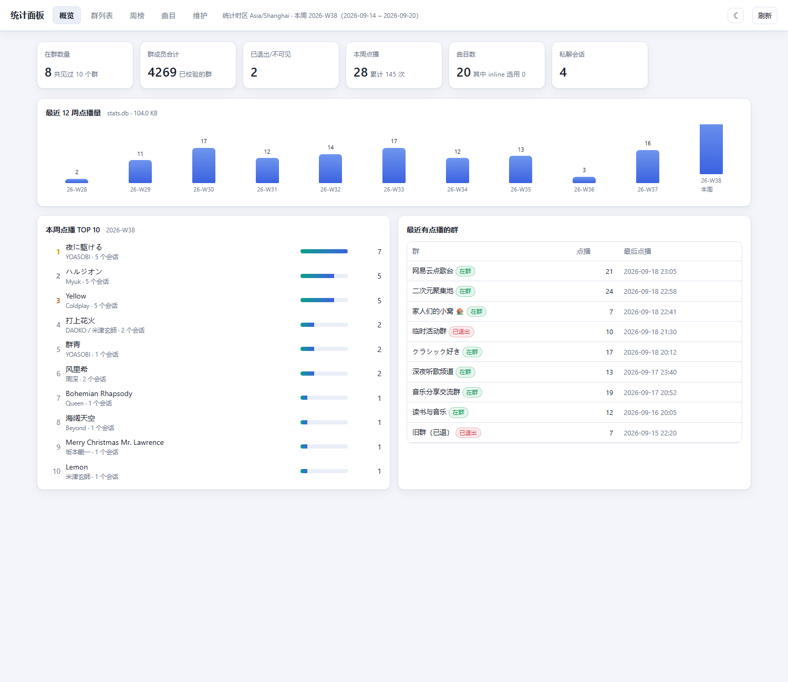
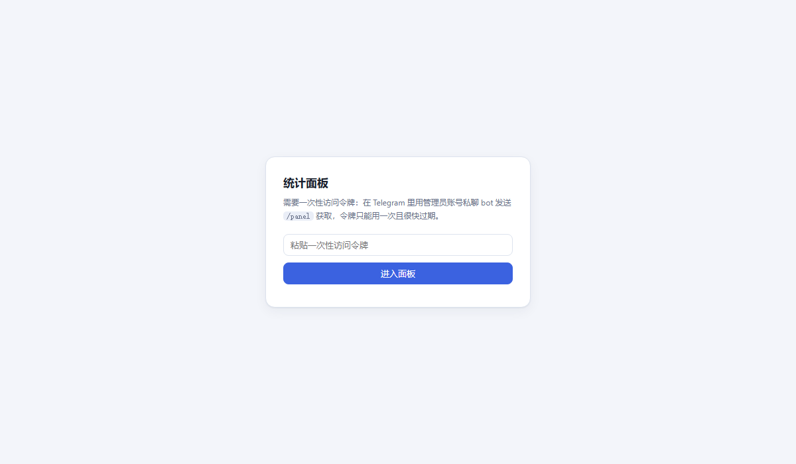

<h1 align="center">Music163bot</h1>

<h4 align="center">一个用来下载/分享/搜索网易云歌曲的telegram bot</h4>

<p align="center">演示bot：<a href="https://t.me/Music163bot">https://t.me/Music163bot</a></p>

<p align="center">
	<a href="https://goreportcard.com/report/github.com/XiaoMengXinX/Music163bot-Go/v2">
      
	</a>
	<a href="https://github.com/XiaoMengXinX/Music163bot-Go/releases">
      
  	</a>
	<a href="https://tgbotmau.quoi.dev/?bot=Music163bot" target="_blank">
		
	</a>
</p>

## ✨ 特性

- 分享链接嗅探
- inlinebot
- 歌曲搜索
- 为歌曲文件添加163key
- 歌曲快速分享
- 下载无损flac音频 （需设置网易云VIP账号的MUSIC_U)
- 动态更新（使用 [traefik/yaegi](https://github.com/traefik/yaegi) 作为动态扩展框架）

## ⚙️ 构建

构建前请确保拥有 `Go 1.17`或更高版本

**克隆代码**

```
git clone https://github.com/XiaoMengXinX/Music163bot-Go
```

**使用脚本自动编译 ( 支持 windows 的 bash 环境，例如 git bash )**

```
cd Music163bot-Go
bash build.sh 

# 也可以加入环境变量以交叉编译，如
GOOS=windows GOARCH=amd64 bash build.sh
```

## 🛠️ 部署

**修改配置文件**

打开项目根目录下的 `config_example.ini`

```
# 以下为必填项
# 你的 Bot Token
BOT_TOKEN = YOUR_BOT_TOKEN

# 你的网易云 cookie 中 MUSIC_U 项的值（用于下载无损歌曲）
MUSIC_U = YOUR_MUSIC_U


# 以下为可选项
# 自定义 telegram bot API 地址
BotAPI = https://api.telegram.org

# 设置 bot 管理员 ID, 用 “," 分隔
BotAdmin = 1234,3456

# 是否开启 bot 的 debug 功能
BotDebug = false

# 自定义 sqlite3 数据库文件 （默认为 cache.db）
Database = cache.db

# 设置日志等级 [panic|fatal|error|warn|info|debug|trace] (默认为 info)
LogLevel = info

# 是否开启自动更新 (默认开启）, 若设置为 false 相当于 -no-update 参数
AutoUpdate = true
 
# 下载文件损坏是否自动重新下载 (默认为 true)
AutoRetry = true

# 最大自动重试次数 (默认为 3)
MaxRetryTimes = 3

# 下载超时时长 (单位秒, 默认为 60)
DownloadTimeout = 60

# 是否校验更新文件 md5 (默认开启）, 若设置为 false 相当于 -no-md5-check 参数
CheckMD5 = true

# 自定义源码路径
SrcPath = ./src

# 自定义 bot 函数入口 (默认为 bot.Start)
BotEntry = bot.Start
```

**※ 修改配置后，将 `config_example.ini` 重命名为 `config.ini`**

**启动 Music163-bot**

```
$ ./Music163bot-Go
2021/10/30 13:05:40 [INFO] Music163bot-Go v2.0.0(20000) (main.go:122)
2021/10/30 13:05:40 [INFO] 正在检查更新中 (main.go:155)
2021/10/30 13:05:40 [INFO] v2.0.0(20000) 已是最新版本 (main.go:361)
2021/10/30 13:05:40 [INFO] 正在校验文件MD5 (main.go:164)
2021/10/30 13:05:40 [INFO] MD5校验成功 (main.go:169)
2021/10/30 13:05:40 [INFO] 加载版本 v2.0.0(20000) 中 (main.go:195)
2021/10/30 13:05:41 [INFO] Music163bot 验证成功 (value.go:543)
```

## 🤖 命令

- `/musicid` 或 `/netease` + `音乐ID`  —— 从 MusicID 获取歌曲
- `/search` + `关键词` —— 搜索歌曲
- `/about` —— 关于本 bot
- `/panel` —— 管理员私聊获取统计面板的一次性访问令牌

## 📊 点播统计面板（可选功能）

在 bot 进程内附带一个 Web 面板，用来回答两个问题：**bot 现在在哪些群里、有多少个群**，以及**按周统计哪些曲目被点播最多**。数据存放在独立的 SQLite 库（默认 `stats.db`，与歌曲缓存 `cache.db` 分离，执行 `/rmcache` 不会影响统计）。



**配置（config.ini）**

```ini
# ===== 点播统计面板 =====
PanelEnable = true                 # false 则完全关闭面板
PanelListen = 0.0.0.0:8099         # 监听地址，浏览器访问 http://<主机IP>:8099/
PanelAuth = token                  # token：管理员私聊 bot 发 /panel 领一次性令牌；none：内网免密
PanelTokenTTL = 300                # 一次性令牌有效期（秒）
#PanelPublicURL = http://192.168.1.10:8099   # 填了之后 /panel 会直接给一键登录链接
StatsDB = stats.db                 # 统计库文件
StatsTimezone = Asia/Shanghai      # 「周」的边界按此时区计算
```

**怎么进面板（默认 `PanelAuth = token`）**

1. 用配置在 `BotAdmin` 里的账号**私聊** bot，发送 `/panel`；
2. bot 回复一个**一次性访问令牌**（默认 5 分钟有效，用过即失效）；
3. 打开面板地址，把令牌粘进去就能进入面板（配了 `PanelPublicURL` 时 bot 会直接给出可点击的登录链接）。

令牌只发给 `BotAdmin` 里的账号，且只在私聊里回复；在群里发 `/panel` 不会有任何响应。登录后拿到 12 小时的会话 Cookie（访问时滑动续期），右上角可以退出登录。



若面板只在完全可信的内网 / VPN 里访问，可以把 `PanelAuth` 改成 `none` 免除认证——**此时任何人都能打开面板，请务必用 `PanelListen` 限制监听地址**。

启动后日志会出现：

```
[INFO] 统计数据库已就绪: stats.db (时区 Asia/Shanghai)
[INFO] 统计面板已启用: http://0.0.0.0:8099/  (统计库 stats.db, 认证: 一次性令牌, 有效期 5m0s)
[INFO] 在 Telegram 里用 BotAdmin 账号私聊 bot 发送 /panel 即可获取访问令牌
[INFO] 历史回填: 已从缓存库回填 1675 条历史点播记录，涉及 122 个会话
```

**「在哪些群」怎么判断**

1. `my_chat_member` 更新（bot 被拉进/踢出群）—— 最准确的实时依据；
2. bot 收到的消息（`can_read_all_group_messages` 已开启，群内消息都能看到）—— 能收到消息就证明 bot 在该群内，同时更新群名与最后活跃时间；
3. 面板「维护 → 校验群状态」会逐个会话调用 `getChat` / `getChatMemberCount`，得到群名、群人数与**是否仍在群**（调用失败即视为已退出）。

**「按周统计」说明**

- 每次成功把音频发进某个会话都记一条点播（命中缓存同样计数，同一首歌多次点播会累加）；
- 周按 `StatsTimezone` 的 ISO 周（周一~周日）切分，可切换周、按会话或仅群聊过滤；
- 首次启动会把 `cache.db` 的历史记录回填进统计库。注意缓存库只保存每首歌**首次**缓存的时间，所以回填得到的是历史点播的下限，重复点播无法还原；实时数据从升级后开始累计；
- inline 模式（群里 `@bot` 选用结果）拿不到所在会话，只能计入曲目总量，在面板中标为 `inline 选用`。

**面板页面**

| 页面 | 内容 |
| --- | --- |
| 概览 | 在群数 / 群成员合计 / 已退出、本周与累计点播、曲目数、最近 12 周柱状图、本周 TOP10、最近有点播的群 |
| 群列表 | 全部会话（群名、Chat ID、类型、人数、在群状态、消息数、点播数、本周点播、最后活跃 / 最后点播），点某一行可按该群看周榜 |
| 周榜 | 按周切换的曲目排行，可只看群聊 / 私聊 / inline，或按 Chat ID 过滤 |
| 曲目 | 按歌名 / 歌手 / MusicID 搜索，点击查看总次数、按周趋势、会话分布、用户分布 |
| 维护 | 历史回填、群状态校验（带进度）、面板与统计库信息 |

界面默认**亮色**，右上角按钮可切换**暗色**（选择记录在浏览器本地，刷新后保留）。更多截图见 `docs/stats-panel/`。

**离线调试**：在 config.ini 里设 `PanelOnly = true`，只启动面板与统计库、不连接 Telegram，便于离线查看数据。

**测试**：`go test ./...` 覆盖统计写入路径、周边界（含跨年与跨时区换算）、回填幂等，以及面板认证（一次性令牌、过期、数量上限、管理员门禁、免密模式）。`deploy/smoke-test-panel.sh` 可在任意装有 Go 与 curl 的机器上对面板做一次端到端自测（离线运行，不连接 Telegram）。

